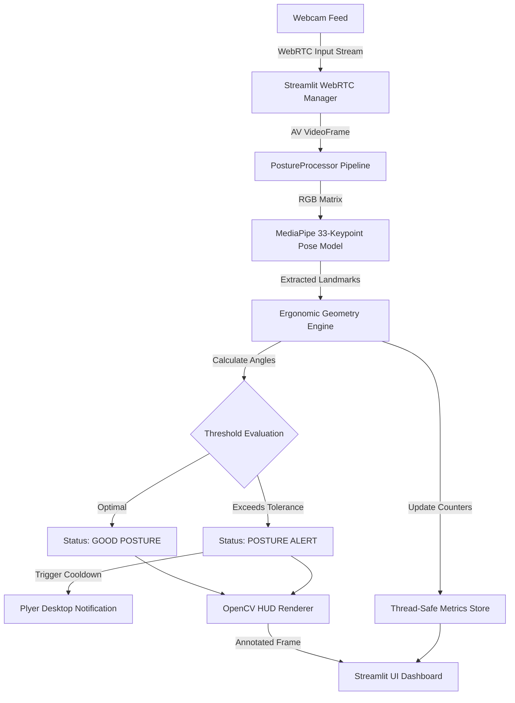

# 🧘‍♂️ Smart Posture System

> **Real-Time Computer Vision Ergonomic Analysis & Health Monitoring System**  
> *Powered by MediaPipe Pose Landmark Detection, OpenCV, Streamlit, and WebRTC.*

[](https://www.python.org/)
[](https://streamlit.io/)
[](https://mediapipe.dev/)
[](https://opencv.org/)
[](LICENSE)

---

## 📌 Overview

**Smart Posture System** is an AI-driven, vision-based ergonomic monitor designed to prevent posture-related muscle strain and long-term spinal issues for workstation users. By leveraging real-time upper-body keypoint extraction from standard webcams, the system continuously measures joint angles—including **shoulder roll**, **spine vertical tilt**, and **head/neck inclination**. 

When poor posture or slouching is detected beyond customizable tolerance thresholds, the system delivers immediate visual HUD diagnostics and desktop notification alerts.

---

## ✨ Key Features

- **⚡ Real-Time WebRTC Video Stream Processing**: Low-latency frame transformations directly inside the browser using `streamlit-webrtc`.
- **🎯 33-Keypoint Pose Tracking**: High-precision upper body skeleton detection powered by MediaPipe Pose solution.
- **📐 Mathematical Telemetry Analytics**:
  - **Shoulder Roll Tilt ($\theta_{shoulder}$)**: Detects uneven shoulder alignment.
  - **Spine Vertical Alignment ($\theta_{spine}$)**: Measures forward/backward trunk deviation relative to gravity.
  - **Neck & Head Inclination ($\theta_{neck}$)**: Identifies Forward Head Posture (FHP) or tech-neck.
- **🎨 Glassmorphic HUD Overlay**: Dynamic OpenCV visual overlay featuring color-coded status badges (Emerald Green for Good Posture vs. Crimson Red for Alert), joint nodes, and vector lines.
- **⚙️ Custom Ergonomic Threshold Controls**: Interactive sliders allowing users to tailor sensitivity and alert cooldowns.
- **🔔 Desktop System Notifications**: Non-intrusive background reminder notifications triggered via `plyer`.
- **📊 Live Session Dashboard**: Real-time ergonomic health score percentage, session counters, and angle telemetry.

---

## 🧮 Mathematical Foundation

The posture tracking pipeline computes three primary angular vectors from pixel coordinates $(x, y)$ of extracted body landmarks:

1. **Shoulder Roll Angle ($\theta_{shoulder}$)**:
   $$\theta_{shoulder} = \left| \arctan2(y_{right\_shoulder} - y_{left\_shoulder},\, x_{right\_shoulder} - x_{left\_shoulder}) \right| \times \frac{180}{\pi}$$

2. **Spine Vertical Inclination ($\theta_{spine}$)**:
   Given shoulder midpoint $S = \frac{L_{shoulder} + R_{shoulder}}{2}$ and hip midpoint $H = \frac{L_{hip} + R_{hip}}{2}$:
   $$\theta_{spine} = \left| \arctan2(S_x - H_x,\, S_y - H_y) \right| \times \frac{180}{\pi}$$

3. **Neck Angle ($\theta_{neck}$)**:
   Given head center $E = \frac{L_{ear} + R_{ear}}{2}$ (or Nose landmark):
   $$\theta_{neck} = \left| \arctan2(E_x - S_x,\, E_y - S_y) \right| \times \frac{180}{\pi}$$

---

## 🏗️ System Architecture



---

## 🚀 Quick Start Guide

### 1. Prerequisites

Ensure you have Python 3.9 or higher installed on your system:
```bash
python --version
```

### 2. Clone Repository & Install Dependencies

```bash
git clone https://github.com/YOUR_USERNAME/smart-posture-system.git
cd smart-posture-system
pip install -r requirements.txt
```

### 3. Run the Application

Start the Streamlit Web Application:
```bash
streamlit run main.py
```

Open your browser at `http://localhost:8501`, grant camera access, and click **START** on the webcam streamer.

---

## 📁 Repository Structure

```
smart-posture-system/
├── main.py              # Main Streamlit web application & WebRTC video processor
├── requirements.txt     # Python project dependencies
├── .gitignore           # Standard git ignore rules
└── README.md            # Comprehensive project documentation
```

---

## 🛠️ Tech Stack

- **Frontend & Web Framework**: [Streamlit](https://streamlit.io/), HTML5/CSS3 (Glassmorphism design system)
- **Streaming Pipeline**: [streamlit-webrtc](https://github.com/whitphx/streamlit-webrtc), PyAV
- **Computer Vision & ML**: [MediaPipe](https://mediapipe.dev/), [OpenCV](https://opencv.org/), NumPy
- **OS Integration**: [Plyer](https://github.com/kivy/plyer)

---

## 📄 License

Distributed under the MIT License. See `LICENSE` for details.
